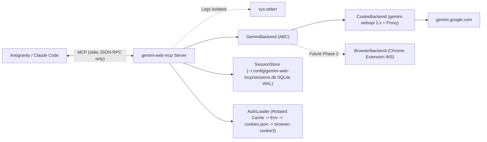

# Implementation Plan: `gemini-web-mcp`

## Goal Description

在 `/Users/ut0pia/agent/gemini-web-mcp` 新建并开源一个现代化的 MCP（Model Context Protocol）Server 项目，将 **Web 端 Gemini（`gemini.google.com`）** 包装为供 Antigravity、Claude Code、Cursor 等 AI 编程助手按需调用的“外包 Subagent”。

结合已有开源项目的优势与痛点：
- 吸收 **TakashiAihara/gemini-web-mcp** 的**标签化多轮会话持久化**与**模型/思考模式切换**；
- 吸收 **AndyShaman/gemini-webapi-mcp** 的**多模态文件上传分析**与**多级 Cookie 自动提取**能力；
- 吸收 **Walkoud/gemini-browser-mcp** 的**可插拔后端抽象**与**长思考超时自适应**思路；
- 解决上述仓库长期未维护、缺少并发与跨进程安全保护、日志污染 `stdio`、缺少测试与工程化规范的问题，构建一个**“统一 MCP 接口 + 可插拔后端抽象”**的轻量、可靠、易开源维护的 Python MCP Server。

---

## Confirmed Decisions

1. **开源协议：AGPL-3.0**
   - 直接依赖上游 `HanaokaYuzu/Gemini-API`（`gemini-webapi>=2.1.0,<3.0.0`，AGPL-3.0），本项目同步采用 **AGPL-3.0**，先自用打磨，成熟后开源至个人 GitHub，协议完全合规且零额外拆分成本。
2. **首期范围：仅 Phase 1（MVP）**
   - 首期完整落地 **Python MCP Server + `CookieBackend`（基于 `gemini-webapi` 2.x）+ 多级鉴权与刷新缓存协同 + SQLite WAL 标签化持久化会话 + 多模态文件安全校验与分析 + 单元测试 + CI + 开源文档与 Skill/Rule 模板**。
   - 在代码中保留 `GeminiBackend` 抽象基类，为后续扩展 Phase 2（Chrome 扩展 + WebSocket 桥接）预留接入点，但首期不包含浏览器扩展代码。
3. **工具列表：精简 3 工具（暂不支持生图）**
   - 首期仅暴露 `gemini_ask`、`gemini_sessions`、`gemini_health` 三个核心工具（附带标准 MCP `ToolAnnotations`），专注于文本推理、大文件/日志/多模态分析、代码/架构第二视角评审，避免冗余工具占用主 Agent 上下文。
4. **Python 版本与本地集成：Python `>=3.11`（`uv` 托管）**
   - 对齐上游 `gemini-webapi` 2.x 的 `Requires-Python >=3.11` 要求；本机将通过 `brew install uv` 托管 Python 3.12+ 虚拟环境并支持 `uv` / `uvx` 运行。
   - 自动化与连通性验证完成后，使用 `uv --directory /Users/ut0pia/agent/gemini-web-mcp run gemini-web-mcp` 将本项目注册到 `~/.gemini/config/mcp_config.json`。

---

## Architecture Overview



### 核心 MCP 工具设计（高信噪比、面向 Subagent）

| 工具名 | 注解 (`ToolAnnotations`) | 用途 | 关键参数与行为 |
| :--- | :--- | :--- | :--- |
| `gemini_ask` | `openWorldHint=True` | 向 Web 端 Gemini 发起文本/多模态问答、代码/架构第二视角评审 | `prompt`, `session`（默认 `"default"`）, `new_chat`（默认 `False`）, `model`（`str`，支持 `flash`/`pro`/`thinking`/`unspecified` 语义别名及上游动态模型名；续聊默认沿用会话原模型，防止跨模型触发 `1050` 错误）, `files`（本地文件路径列表，含安全与体积校验）, `include_thoughts`（默认 `False`）。返回文本末尾附带 `[session: <label> \| turn: <n> \| model: <model>]` 状态行 |
| `gemini_sessions` | 按动作区分读写语义 | 管理本地持久化的命名会话 | `action` (`list` / `get` / `delete` / `clear`), `session` |
| `gemini_health` | `readOnlyHint=True` | 检查鉴权状态、当前激活后端、生效代理（脱敏）、可用动态模型与连接状态 | 无 |

---

## Proposed Changes

在 `/Users/ut0pia/agent/gemini-web-mcp` 下创建完整开源项目结构：

### Project Scaffold & Tooling

#### [NEW] pyproject.toml
配置项目元数据、`requires-python = ">=3.11"`、入口脚本 `gemini-web-mcp = "gemini_web_mcp.server:main"`（支持 `uv run` / `uvx` / `pipx` 直接运行），以及核心依赖：
- `mcp>=1.2.0`（FastMCP / Stdio Server / `ToolAnnotations` / Progress 心跳）
- `gemini-webapi>=2.1.0,<3.0.0`
- `pydantic>=2.0`、`pydantic-settings>=2.0`
- 可选扩展组 `[project.optional-dependencies]`：
  - `browser-cookies = ["gemini-webapi[browser]"]`（复用上游 `browser-cookie3` 集成）
  - `dev = ["pytest", "pytest-asyncio", "ruff", "mypy"]`

#### [NEW] .gitignore
忽略 `.venv/`、`__pycache__/`、`*.pyc`、`dist/`、`cookies.json`、`*.db`、`*.db-wal`、`*.db-shm`、`.env`、`.pytest_cache/`、`.mypy_cache/`、`.ruff_cache/` 等敏感或构建产物。

#### [NEW] LICENSE
写入 GNU Affero General Public License v3.0（AGPL-3.0）完整协议文本。

#### [NEW] README.md
面向开源用户的中英双语说明：
- 核心特性与架构图；
- 快速安装与运行（本地源码 `uv --directory ...`、GitHub `uvx --from git+...`、未来 PyPI `uvx`）；
- **GUI 客户端代理配置说明**（强调 macOS GUI 应用不继承 Shell 代理变量，示范配置 `GEMINI_WEB_MCP_PROXY`）与客户端请求超时建议；
- **Cookie 获取与保活最佳实践**（推荐独立 Google 账号防挤下线、手动导出 Cookie 与 `browser-cookie3` 在 Chrome 130+ App-Bound/Keychain 限制下的注意事项）；
- Antigravity / Claude Code / Cursor 接入配置示例、按需加载 `SKILL.md` 与 `GEMINI.md` 路由模板及免责声明。

#### [NEW] .github/workflows/ci.yml
GitHub Actions 工作流：在 Python `3.11` / `3.12` / `3.13` 矩阵上使用 `uv` 自动运行 `ruff check`、`mypy` 与 `pytest`。

---

### Core Server & Domain Modules (`src/gemini_web_mcp/`)

#### [NEW] src/gemini_web_mcp/__init__.py
导出包版本与核心类型。

#### [NEW] src/gemini_web_mcp/config.py
基于 `pydantic-settings` 管理配置（支持环境变量前缀 `GEMINI_WEB_MCP_*`）：
- `backend`: `"cookie"`（预留扩展接口）
- `default_model`: 默认模型名或别名（默认 `"unspecified"`，支持 `flash` / `pro` / `thinking` 或具体模型标识）
- `proxy`: `str | None = None`（优先读取 `GEMINI_WEB_MCP_PROXY`，回退读取 `HTTPS_PROXY` / `HTTP_PROXY` / `ALL_PROXY`，解决 GUI 客户端无 Shell 环境变量导致 `curl-cffi` 直连超时问题）
- `cookies_path`: 默认 `~/.config/gemini-web-mcp/cookies.json`
- `sessions_db_path`: 默认 `~/.config/gemini-web-mcp/sessions.db`
- `timeout_seconds`: 常规请求 `120` 秒，Thinking 模式自动放宽至 `300` 秒
- `max_files_per_request`: 默认 `10`
- `max_file_size_mb`: 默认 `20`（单文件体积上限）
- `log_level`: 默认 `"WARNING"`

#### [NEW] src/gemini_web_mcp/auth.py
多级 Cookie 加载与刷新缓存协同器：
1. **种子凭据来源**（优先级从高到低）：
   - 环境变量：`GEMINI_SECURE_1PSID` + 可选 `GEMINI_SECURE_1PSIDTS`
   - 配置文件：`cookies.json`（兼容 `{name: value}` 字典或浏览器插件导出的 Cookie 数组格式）
   - 浏览器自动提取（可选）：尝试通过 `browser-cookie3` 提取 `.google.com` 域 Cookie，并在 macOS Keychain / Chrome 130+ 加密权限受阻时给出清晰的可操作指引。
2. **与 `1PSIDTS` 轮换缓存协同**：
   - `__Secure-1PSIDTS` 生命周期短且由 `gemini-webapi` 后台 `auto_refresh=True` 动态轮换并缓存；初始化时避免用静态配置中已过期的旧 `1PSIDTS` 盲目覆盖本地已刷新的有效缓存，若缓存失效触发 `AuthError` 再自动回退重读最新配置或提示更新 Cookie。

#### [NEW] src/gemini_web_mcp/sessions.py
多进程 + 多协程双安全的本地会话存储（基于标准库 `sqlite3`）：
- **跨进程并发安全**：采用 SQLite **WAL 模式**（`PRAGMA journal_mode=WAL; PRAGMA busy_timeout=5000;`）持久化至 `sessions.db`，零第三方依赖，彻底避免同时开启多个 Antigravity / Cursor / Claude Code 窗口（多个独立 `stdio` 子进程）时全量覆写 JSON 互相冲掉会话数据。
- **单进程内按标签加锁**：维护 `label -> asyncio.Lock` 字典，保证同一 `session` 标签的多轮请求严格串行更新 `metadata`，而不同 `session` 标签的请求可完全并行执行。
- **完整保留 `metadata` 列表**：数据结构定义为 `SessionRecord(label, metadata: list[str | None], model: str, created_at, updated_at, turn_count)`，原样保存 `chat.metadata` 完整数组（兼容 `cid`、`rid`、`rcid` 及 Google Web RPC 尾部扩展上下文标识如 `esid`），不做硬编码三元组截断。

#### [NEW] src/gemini_web_mcp/files.py
本地附件上传前置安全与边界校验器 `validate_upload_files`：
- 校验文件数量不超过 `max_files_per_request`（默认 10 个）；
- 解析软链接真实路径（`Path.resolve()`），确保目标存在且为常规文件（拒绝目录、FIFO/设备文件）；
- 校验单文件大小不超过 `max_file_size_mb`（默认 20MB），防止超大日志撑爆内存或超时；
- 内置敏感路径黑名单拦截（拒绝上传 `~/.ssh`、`~/.aws`、`~/.gnupg`、`**/.env`、`.env.*` 以及本项目自身的 `cookies.json` / `sessions.db`），防范潜在的 Prompt Injection 凭据外泄。

#### [NEW] src/gemini_web_mcp/backends/base.py
定义抽象基类 `GeminiBackend` 与统一数据模型 `AskRequest`、`AskResponse`、`HealthStatus`：
- `async def init(self) -> None`
- `async def ask(self, req: AskRequest) -> AskResponse`
- `async def health(self) -> HealthStatus`
- `async def close(self) -> None`

#### [NEW] src/gemini_web_mcp/backends/cookie_backend.py
封装 `gemini_webapi.GeminiClient`（2.x）：
- **并发安全的懒加载初始化**：不在 MCP 握手阶段联网，首次实际调用时通过全局 `asyncio.Lock`（Double-Checked Locking）执行 `await client.init(timeout=..., auto_close=False, auto_refresh=True)` 并透传 `proxy`，防止并发请求触发多次 `init()` 导致 `1PSIDTS` 互踢失效；
- **动态模型解析 + 续聊模型一致性保护**：
  - 将 `flash` / `pro` / `thinking` / `unspecified` 语义别名映射至 `client.resolve_model(...)`，同时允许直接透传上游支持的原始模型名；
  - 续聊已有 `session`（且 `new_chat=False`）时：若调用方未显式传 `model`，自动沿用 `SessionRecord.model`；若显式传入了与该会话创建时不同的模型，主动拦截并返回清晰提示（指引设置 `new_chat=True` 或切换新 `session` 标签），避免直接请求触发 Google 后端神秘的 `1050` 错误；
- **附件透传与可读异常转换**：调用 `validate_upload_files` 后上传本地文件；捕获 `AuthError`、风控拦截、代理网络不可达与超时异常，统一转换为对主 Agent 友好的可操作诊断提示，杜绝裸栈追踪。

#### [NEW] src/gemini_web_mcp/server.py
基于 `mcp.server.fastmcp.FastMCP` 暴露标准 `stdio` MCP Server：
- **`stdout` 纯净度强保护（启动首行执行）**：在导入和运行 `gemini_webapi` 前立即执行 `loguru.logger.remove()`，并将 `loguru` 与标准库 `logging` 严格重定向至 `sys.stderr`（默认 `WARNING` 级别），严防任何第三方 `INFO` 日志写入 `stdout` 破坏 JSON-RPC 帧；
- 注册 `gemini_ask`、`gemini_sessions`、`gemini_health` 三个工具及对应 `ToolAnnotations`；
- 在长耗时请求（如 `thinking` 模式）期间通过 MCP `Context.report_progress` 发送周期性心跳，降低客户端超时断连概率；
- 在 `gemini_ask` 输出末尾固定拼接精简会话状态行 `[session: <label> | turn: <n> | model: <model>]`，辅助主 Agent 感知轮次与模型状态；
- 注册 `lifespan` 钩子，退出时优雅调用 `await backend.close()` 停止后台刷新任务并释放连接。

---

### Examples & Tests

#### [NEW] examples/skills/gemini-web/SKILL.md
面向 Antigravity 的按需加载 Skill 模板（可放入项目 `.agents/skills/gemini-web/SKILL.md` 或全局 `~/.gemini/config/skills/gemini-web/SKILL.md`），利用 Progressive Disclosure 在平时保持零常驻上下文开销，仅在需要外部第二视角评审或大文件/多模态分析时激活完整调用规范。

#### [NEW] examples/GEMINI.md
适用于项目根目录 `GEMINI.md` / `AGENTS.md`（以及 Gemini CLI `~/.gemini/GEMINI.md`、Claude Code `~/.claude/CLAUDE.md`）的轻量路由规则模板，包含触发条件、上下文打包规范与会话标签命名建议。

#### [NEW] tests/test_sessions.py
测试会话的创建、读取、更新、删除、清空、4+ 元素完整 `metadata` 列表无损持久化、同标签协程串行锁，以及多 SQLite 连接（模拟多 IDE 窗口多进程）并发读写不丢数据。

#### [NEW] tests/test_auth.py
测试环境变量、JSON 文件（字典/Cookie 数组两种格式）、缓存协同回退逻辑以及缺失 Cookie 时的可读错误提示。

#### [NEW] tests/test_files.py
测试附件数量上限、单文件体积超限拦截、目录/不存在路径拒绝，以及软链穿透敏感路径（`~/.ssh`、`.env`、`cookies.json`）的安全拦截。

#### [NEW] tests/test_server.py
使用 Mock `GeminiBackend` 测试：
- `gemini_ask`（新建会话、续聊自动继承模型、跨模型切换拦截提示、`new_chat=True` 重置、附件传递、状态行拼接）；
- `gemini_sessions`（`list` / `get` / `delete` / `clear`）与 `gemini_health`；
- **MCP `stdio` 纯净度断言**：验证日志重定向逻辑确保无任何非协议日志写入 `stdout`。

---

## Verification Plan

### Automated Tests
在 `/Users/ut0pia/agent/gemini-web-mcp` 目录下执行：
```bash
brew install uv
uv sync --extra dev
uv run ruff check src tests
uv run mypy src
uv run pytest -v
```
验证所有单元测试、类型检查、代码风格检查、Mock MCP 工具调用、文件安全边界与 SQLite WAL 会话持久化逻辑全部通过。

### Manual Verification
1. **CLI / MCP `stdio` 纯净度与协议自检**：通过 MCP Client / JSON-RPC `initialize` + `tools/list` 握手调用 `uv run gemini-web-mcp`，确认 `stdout` 仅输出合法 JSON-RPC 帧、日志全部落入 `stderr`，且 3 个工具 Schema 与 `ToolAnnotations` 正常暴露。
2. **真实环境与代理连通性验证**（需配置 Cookie 与本地代理）：调用 `gemini_health` 验证登录态、生效代理与动态模型列表；调用 `gemini_ask` 验证单轮问答、同一 `session` 标签下的多轮追问以及跨模型续聊保护提示。
3. **Antigravity 集成验证**：在 `~/.gemini/config/mcp_config.json` 中注册 `uv --directory /Users/ut0pia/agent/gemini-web-mcp run gemini-web-mcp`（附带 `GEMINI_WEB_MCP_PROXY` 环境变量如需要），验证 Antigravity 中可正常识别并调用 `gemini_health` 与 `gemini_ask`。
