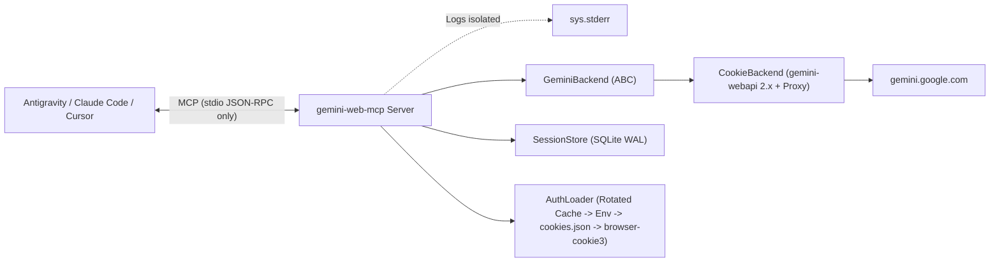

# gemini-web-mcp

Modern, lightweight, process-safe MCP (Model Context Protocol) Server that wraps **Web Gemini (`gemini.google.com`)** as an on-demand subagent for AI coding assistants (**Antigravity**, **Claude Code**, **Cursor**, **Gemini CLI**).

现代化、轻量级、跨进程并发安全的 MCP Server，将 **Web 端 Gemini（`gemini.google.com`）** 包装为供 AI 编程助手按需调用的“外包 Subagent”。

---

## Features / 核心特性

- **Lean 3-Tool Surface / 精简高信噪比三工具**：
  - `gemini_ask` (`openWorldHint=True`): Multi-turn text & multimodal Q&A, model/thinking selection, progress heartbeats, and `[session | turn | model]` status footer.
  - `gemini_sessions`: Manage persistent named sessions (`list` / `get` / `delete` / `clear`).
  - `gemini_health` (`readOnlyHint=True`): Check auth source, masked proxy, available dynamic models, and connectivity.
- **Multi-Process & Async Safe / 多进程与并发安全**：
  - Uses SQLite **WAL mode** (`~/.config/gemini-web-mcp/sessions.db`) + per-label `asyncio.Lock` so multiple IDE windows never clobber each other's sessions, while full `metadata` lists (3 or 4+ elements) are preserved verbatim.
- **Cross-Model `1050` Guard / 跨模型防 `1050` 保护**：
  - Automatically inherits the session's bound model on follow-ups and blocks accidental mid-session model switching before hitting Google's backend.
- **Multi-Source Auth + Rotation Sync / 多级鉴权与轮换缓存协同**：
  - Priority: `GEMINI_SECURE_1PSID` (+ `GEMINI_SECURE_1PSIDTS`) -> `~/.config/gemini-web-mcp/cookies.json` (dict or Cookie-Editor array) -> optional `browser-cookie3`, coordinated with `gemini-webapi`'s rotated `1PSIDTS` cache.
- **Strict `stdio` Purity / `stdio` 零污染**：
  - Forces `loguru` and stdlib `logging` onto `sys.stderr` at startup before importing third-party clients so `stdout` carries pure JSON-RPC frames only.
- **Upload Security Guardrails / 附件上传安全校验**：
  - Resolves symlinks and blocks `~/.ssh`, `~/.aws`, `~/.gnupg`, `.env*` (except `.env.example`), `cookies.json`, `sessions.db`, directories, and oversized files (`>20 MB` default).
- **Pluggable Backend Architecture / 可插拔后端抽象**：
  - Built around `GeminiBackend` ABC (`CookieBackend` today, cleanly extensible for future browser-bridge backends).

## Architecture / 架构概览



---

## Installation & Running / 安装与运行

Requires **Python >= 3.11** (managed via [`uv`](https://docs.astral.sh/uv/)).

### Option 1: From Local Checkout / 本地源码运行

```bash
git clone https://github.com/<your-username>/gemini-web-mcp.git
cd gemini-web-mcp
uv sync --python 3.12 --extra dev
uv run gemini-web-mcp
```

### Option 2: Direct via `uvx` from GitHub / 直接通过 `uvx` 运行

```bash
uvx --from git+https://github.com/<your-username>/gemini-web-mcp.git gemini-web-mcp
```

*(Once published to PyPI: `uvx gemini-web-mcp`)*

*(Optional)* To enable local browser cookie extraction fallback:

```bash
uv sync --extra browser-cookies
```

---

## Authentication & Cookies / 鉴权与 Cookie 获取

> **Best Practice / 最佳实践**:
> - Use a **dedicated secondary Google account** for automation if possible to avoid session eviction from your primary browser.
> - **macOS / Chrome 130+ Note**: Chrome's App-Bound Encryption and macOS Keychain prompts can block `browser-cookie3`. Manual export to `cookies.json` or environment variables is the most reliable setup.

### Method A: `~/.config/gemini-web-mcp/cookies.json` (Recommended)

1. Log in to `https://gemini.google.com` in your browser.
2. Open DevTools (`Application` -> `Cookies` -> `https://gemini.google.com`) or a cookie exporter extension, and copy `__Secure-1PSID` and (if present) `__Secure-1PSIDTS`.
3. Save either a simple key-value JSON object or a Cookie-Editor JSON array to `~/.config/gemini-web-mcp/cookies.json`:

```json
{
  "__Secure-1PSID": "your-1psid-cookie-value",
  "__Secure-1PSIDTS": "your-1psidts-cookie-value"
}
```

### Method B: Environment Variables / 环境变量

```bash
export GEMINI_SECURE_1PSID="your-1psid-cookie-value"
export GEMINI_SECURE_1PSIDTS="your-1psidts-cookie-value"
```

---

## Proxy & Timeout Configuration (macOS GUI Clients!) / 代理与超时配置

**Important for macOS GUI apps (Antigravity IDE, Cursor, Claude Desktop)**: GUI apps launched from Finder/Dock do **not** inherit shell proxy variables (`HTTP_PROXY` / `HTTPS_PROXY`) from `~/.zshrc`. Set `GEMINI_WEB_MCP_PROXY` explicitly in your MCP client's `env` block if your network requires a proxy to reach `gemini.google.com`:

```json
"env": {
  "GEMINI_WEB_MCP_PROXY": "http://127.0.0.1:7890",
  "GEMINI_WEB_MCP_LOG_LEVEL": "WARNING"
}
```

### Environment Variables Reference / 环境变量一览

| Variable | Default | Description |
| :--- | :--- | :--- |
| `GEMINI_WEB_MCP_PROXY` | Fallback to `HTTPS_PROXY` / `HTTP_PROXY` / `ALL_PROXY` | HTTP/SOCKS proxy URL passed to `curl-cffi` |
| `GEMINI_WEB_MCP_DEFAULT_MODEL` | `unspecified` | Default model (`unspecified`, `flash`, `pro`, `thinking`, or exact name) |
| `GEMINI_WEB_MCP_COOKIES_PATH` | `~/.config/gemini-web-mcp/cookies.json` | Path to JSON cookie file |
| `GEMINI_WEB_MCP_SESSIONS_DB_PATH` | `~/.config/gemini-web-mcp/sessions.db` | Path to SQLite WAL session store |
| `GEMINI_WEB_MCP_TIMEOUT_SECONDS` | `120` | Standard request timeout (seconds) |
| `GEMINI_WEB_MCP_THINKING_TIMEOUT_SECONDS` | `300` | Timeout when `thinking` mode is active |
| `GEMINI_WEB_MCP_MAX_FILES_PER_REQUEST` | `10` | Max attachments per `gemini_ask` call |
| `GEMINI_WEB_MCP_MAX_FILE_SIZE_MB` | `20` | Max size per attachment (MB) |
| `GEMINI_WEB_MCP_LOG_LEVEL` | `WARNING` | `stderr` log level (`DEBUG`/`INFO`/`WARNING`/`ERROR`) |

> **Client Timeout Tip**: For `model="thinking"` or large file uploads, configure your MCP client's tool call timeout >= `300` seconds if supported. `gemini-web-mcp` emits MCP progress heartbeats every 10 seconds to reduce idle-disconnects.

---

## Client Configuration Examples / 客户端接入示例

### Antigravity (`~/.gemini/config/mcp_config.json`)

```json
{
  "mcpServers": {
    "gemini-web-mcp": {
      "command": "uv",
      "args": [
        "--directory",
        "/path/to/gemini-web-mcp",
        "run",
        "gemini-web-mcp"
      ],
      "env": {
        "GEMINI_WEB_MCP_PROXY": "http://127.0.0.1:7890",
        "GEMINI_WEB_MCP_LOG_LEVEL": "WARNING"
      }
    }
  }
}
```

### Claude Code / Cursor

```json
{
  "mcpServers": {
    "gemini-web-mcp": {
      "command": "uvx",
      "args": [
        "--from",
        "git+https://github.com/<your-username>/gemini-web-mcp.git",
        "gemini-web-mcp"
      ],
      "env": {
        "GEMINI_WEB_MCP_LOG_LEVEL": "WARNING"
      }
    }
  }
}
```

### Progressive Disclosure Skill & Routing Templates / Skill 与路由规则模板

- Copy [`examples/skills/gemini-web/SKILL.md`](./examples/skills/gemini-web/SKILL.md) to `.agents/skills/gemini-web/SKILL.md` (or `~/.gemini/config/skills/gemini-web/SKILL.md`) for on-demand loading without permanent context bloat.
- Copy or adapt [`examples/GEMINI.md`](./examples/GEMINI.md) into your project's `GEMINI.md` / `AGENTS.md` / `CLAUDE.md`.

---

## Development / 本地开发与测试

```bash
uv sync --extra dev
uv run ruff check src tests
uv run mypy src
uv run pytest -v
```

---

## License & Disclaimer / 协议与免责声明

- Licensed under the **GNU Affero General Public License v3.0 (AGPL-3.0)** — see [LICENSE](./LICENSE).
- This project relies on [`gemini-webapi`](https://github.com/HanaokaYuzu/Gemini-API) (AGPL-3.0) to interact with Google Gemini's web interface using user-supplied session cookies. It is not affiliated with or endorsed by Google. Use responsibly and in accordance with applicable terms of service.
